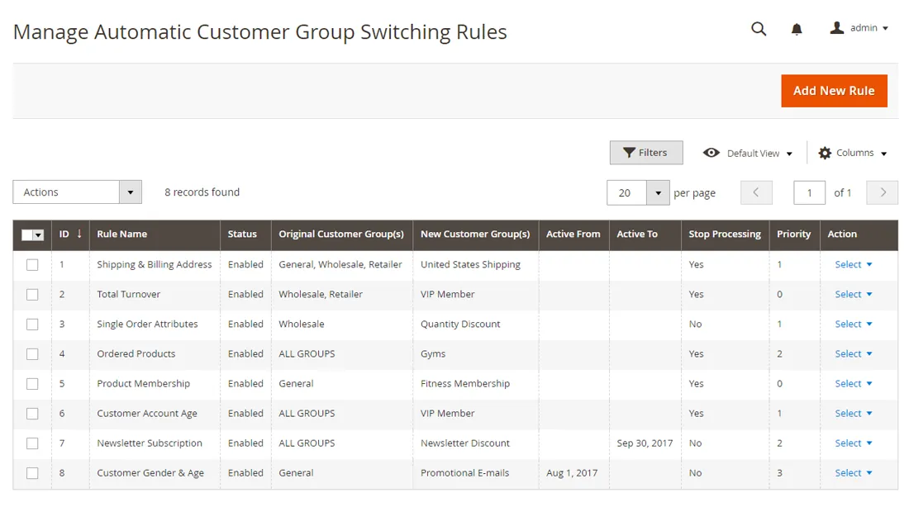
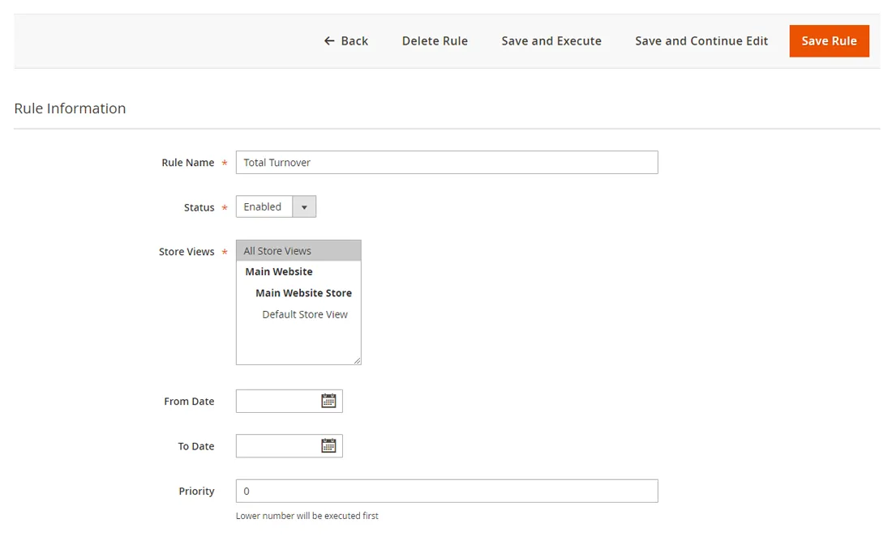
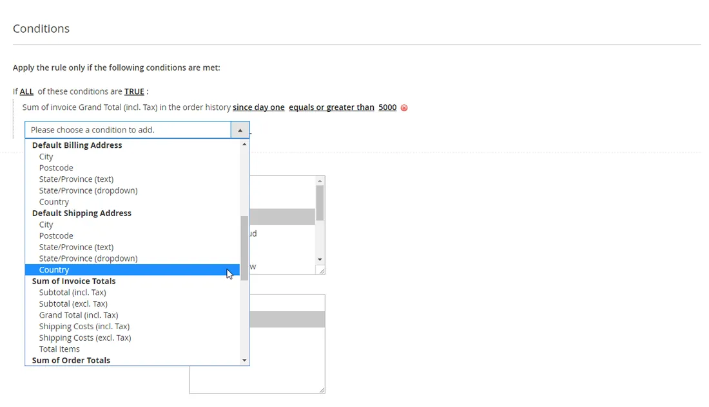
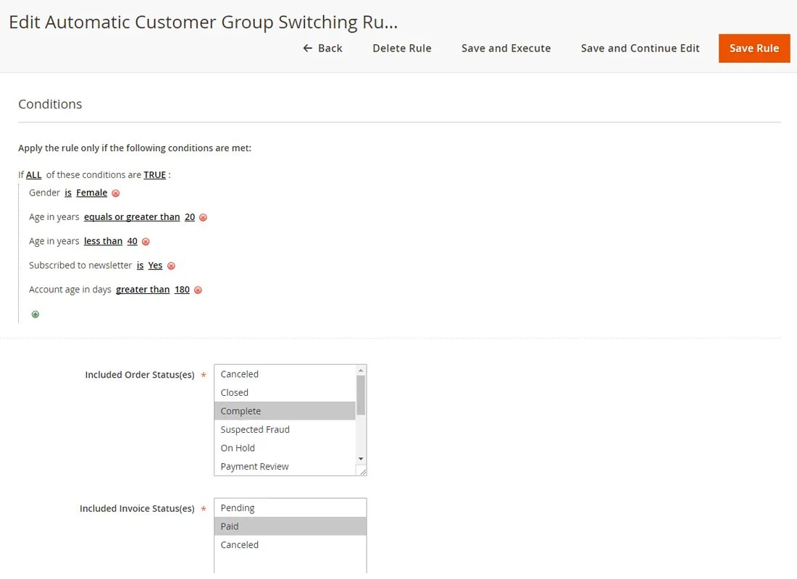
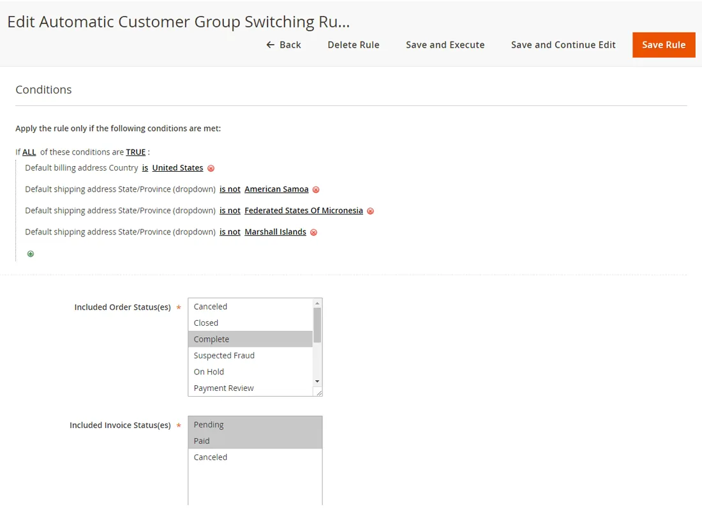
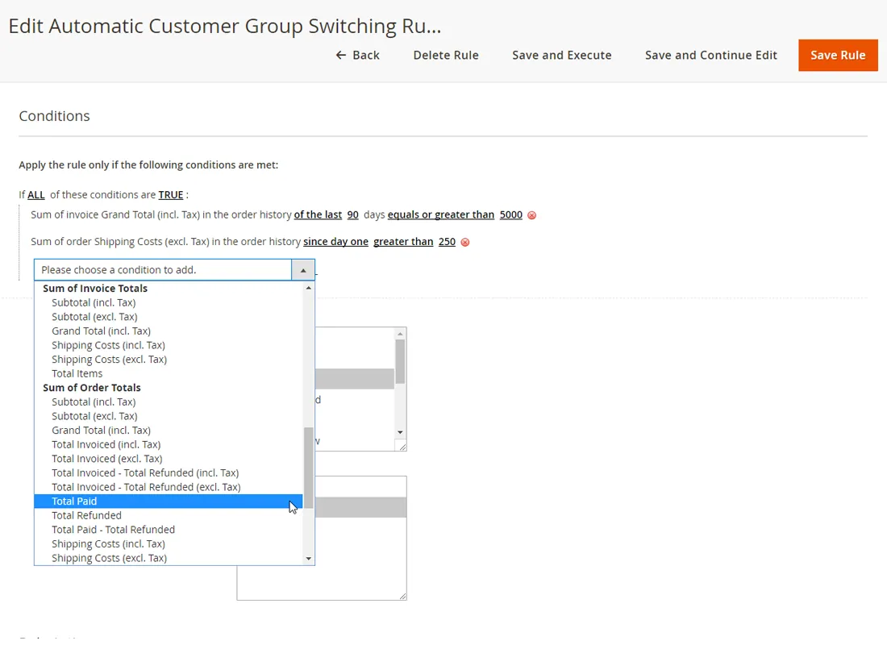
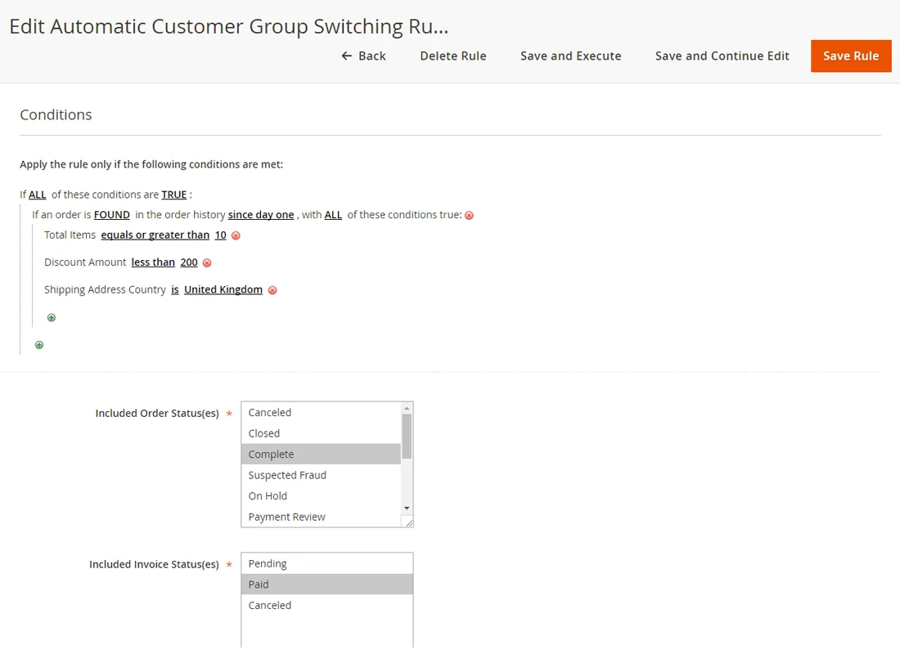

# Automatic Customer Group Switching for Magento 2

**Moves Magento 2 customers between customer groups based on rules you define.**



Moves customers to another customer group automatically, based on group switching rules.

Rules can use customer and address details, aggregated sales, ordered products and product memberships, and run on events, on demand or on a schedule.

> [!NOTE]
> Automatic Customer Group Switching is free and open source under the MIT License (since 2026). Plugin Company no longer actively develops this extension, but issues and pull requests are welcome.

## Features

- Rule-based automatic customer group switching
- Conditions on customer attributes and account details
- Conditions on billing and shipping address (city, region, country)
- Conditions on aggregated sales such as total turnover
- Conditions on ordered product attributes
- Order history time frames, e.g. the last 365 days
- Product memberships with an expiry period
- Rule priority, active period and processing events
- Run single or multiple rules 'on demand'
- Scheduled batch processing via cron
- Optional e-mail notifications to customers and admins

## Screenshots

<table>
  <tr>
    <td width="50%" valign="top"><br><sub>Create new group switching rule</sub></td>
    <td width="50%" valign="top"><br><sub>Configure group switching rule conditions</sub></td>
  </tr>
  <tr>
    <td width="50%" valign="top"><br><sub>Rule based on customer attributes</sub></td>
    <td width="50%" valign="top"><br><sub>Rule based on billing &amp; shipping address</sub></td>
  </tr>
  <tr>
    <td width="50%" valign="top"><br><sub>Rule based on aggregated sales attributes</sub></td>
    <td width="50%" valign="top"><br><sub>Rule based on single order attributes</sub></td>
  </tr>
</table>

More screenshots are on the [product page](https://plugin.company/magento-extensions/automatic-customer-group-switching.html).

## Compatibility

- **Magento:** 2.1.x – 2.4.x
- **PHP:** 5.6 – 8.3 (Composer constraint `~5.6.0|~7.0.2|~7.1|~7.2|~8.0.0|~8.1.0|~8.2.0|~8.3.0`)
- **Latest version:** 100.1.17 (released 2026-10-23)
- **Composer package:** `plugincompany/customergroupswitching`
- **Module:** `PluginCompany_CustomerGroupSwitching`

## Installation

### Composer (recommended)

Run in your Magento 2 root directory:

```bash
composer config repositories.plugin.company composer https://plugin.company/
composer require plugincompany/customergroupswitching
bin/magento module:enable PluginCompany_CustomerGroupSwitching
bin/magento setup:upgrade
```

The plugin.company Composer repository is public and points to the release tags of this GitHub repository; no account or credentials are needed. In production mode also run `bin/magento setup:di:compile` and `bin/magento setup:static-content:deploy`, then `bin/magento cache:flush`.

### Manual installation (ZIP)

Download the ZIP of the latest release from the [tags page](https://github.com/PluginCompany/magento2-automatic-customer-group-switching/tags) ([100.1.17](https://github.com/PluginCompany/magento2-automatic-customer-group-switching/archive/refs/tags/100.1.17.zip)) and copy its contents to `app/code/PluginCompany/CustomerGroupSwitching/`, so that `app/code/PluginCompany/CustomerGroupSwitching/registration.php` exists:

```bash
unzip magento2-automatic-customer-group-switching-100.1.17.zip
mkdir -p app/code/PluginCompany/CustomerGroupSwitching
cp -R magento2-automatic-customer-group-switching-100.1.17/. app/code/PluginCompany/CustomerGroupSwitching/
bin/magento module:enable PluginCompany_CustomerGroupSwitching
bin/magento setup:upgrade
```

See the [installation guide](docs/02-installing-the-extension.md) for the complete step-by-step instructions.

### Upgrading from a purchased copy

If you bought this extension from plugin.company before, you can switch to this open-source release without a license key. Your configuration and data stay as they are.

1. Keep the `plugin.company` repository entry in your `composer.json`: it now serves these GitHub releases with the same package names and version numbers. Credentials for plugin.company in `auth.json` are no longer needed.
2. Remove `plugincompany/licensemanager` from the `require` section of your `composer.json` if it is listed there.
3. Run `composer update plugincompany/customergroupswitching plugincompany/licensemanager` (or simply `composer update`), then `bin/magento setup:upgrade`.

If you installed the ZIP into `app/code/`, replace the files in `app/code/PluginCompany/CustomerGroupSwitching/` with this release. The License Manager module (`app/code/PluginCompany/LicenseManager/`) is not needed by these releases; once all your Plugin Company extensions are updated you can disable it with `bin/magento module:disable PluginCompany_LicenseManager`, delete the folder and run `bin/magento setup:upgrade`.

## Documentation

- [Documentation in this repository](docs/README.md) (Installation Guide, User Manual, Extension FAQ)
- Online documentation: <https://plugin.company/knowledge-base/docs/magento-2-automatic-customer-group-switching/>
- Product page: <https://plugin.company/magento-extensions/automatic-customer-group-switching.html>
- Magento 1 / OpenMage version: [magento1-automatic-customer-group-switching](https://github.com/PluginCompany/magento1-automatic-customer-group-switching)

## Changelog

See [CHANGELOG.md](CHANGELOG.md) for the release history.

## Contributing

Found a bug or have an improvement? Please open an [issue](https://github.com/PluginCompany/magento2-automatic-customer-group-switching/issues) or send a [pull request](https://github.com/PluginCompany/magento2-automatic-customer-group-switching/pulls). Since the extension is no longer actively developed by Plugin Company, fixes from the community are the best way to keep it working on current Magento 2 and PHP versions.

## License

Plugin Company's code in this repository is released under the [MIT License](LICENSE), Copyright (c) 2014-2026 Plugin Company.

No third-party libraries are bundled; see [THIRD-PARTY-NOTICES.md](THIRD-PARTY-NOTICES.md).
