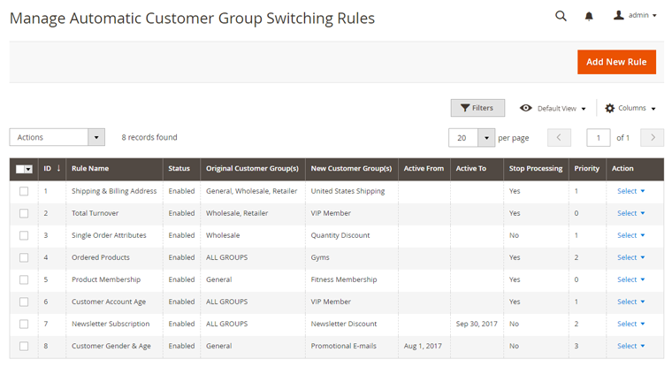

# Configuring Customer Group Switching Rules

To create and manage your customer group switching rules, navigate to **Customers > Automatic Customer Group Switching > Manage Rules** in the left Admin Panel menu.

Create a new rule by clicking the 'Add New Rule' button in the top right corner of the page.

Use the following tabs of the rule view to create and configure your automatic group switching rules:

- [Rule Information](./06-rule-information.md)
- [Conditions](./07-conditions.md)
- [Rule Action](./08-rule-action.md)
- [Customer & Admin Notification](./09-customer-admin-notification.md)

---

[Documentation index](./README.md) · [README](../README.md) · [Online version](https://plugin.company/knowledge-base/docs/magento-2-automatic-customer-group-switching/user-manual/configuring-customer-group-switching-rules/)
