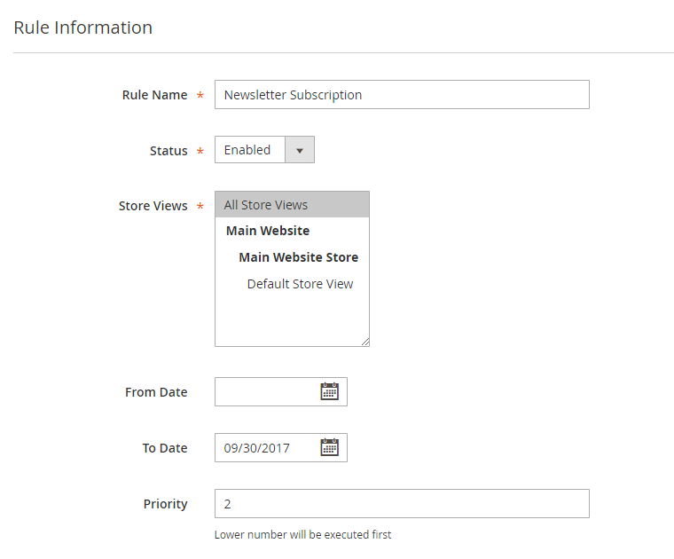

# Rule Information

In the Rule Information tab you can:

- Enter a rule name for admin reference.
- Activate the rule by setting its status to 'enabled'.
- Select the store views for which the group switching rule should be used.
- Optionally set a date range during which the rule should be executed.
- Define the rule's execution priority, starting with 0 as the first rule to be processed.

---

[Documentation index](./README.md) · [README](../README.md) · [Online version](https://plugin.company/knowledge-base/docs/magento-2-automatic-customer-group-switching/user-manual/rule-information/)
