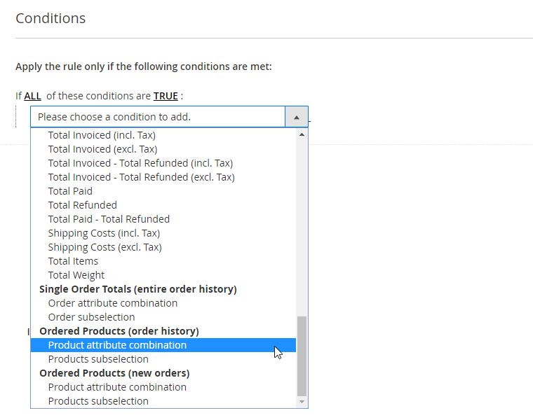
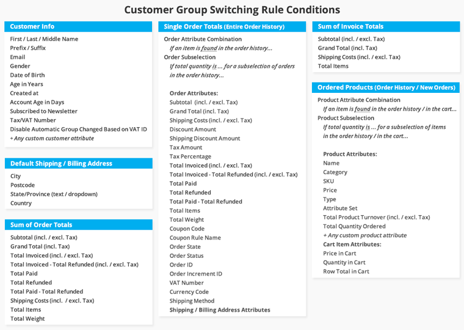
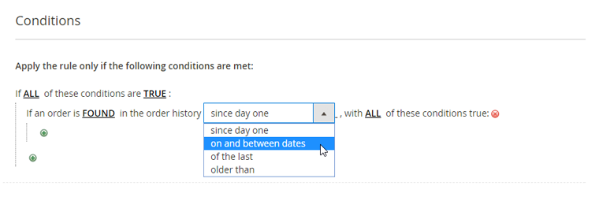
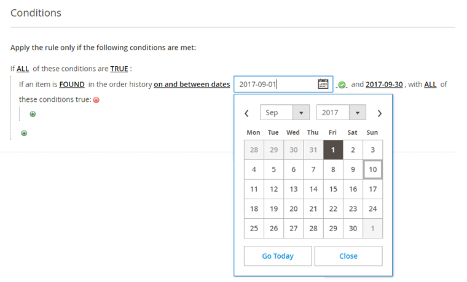
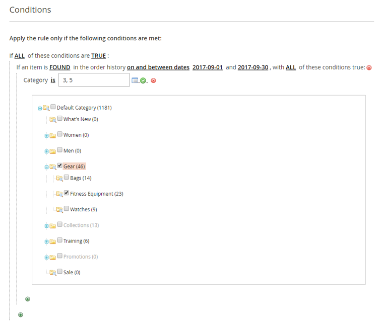
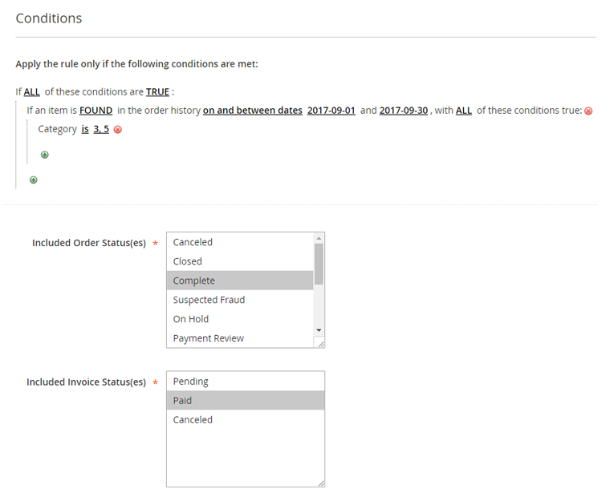

# Conditions

In the Conditions tab you can define the conditions that have to be met for each rule in order to automatically switch a customer to another group and select the included invoice and order status(es).

## Adding Conditions

Click the green + icon to select a condition from a categorized dropdown menu.

The group switching conditions are divided into the following categories:

- **Customer Information**: set up rules based on customer attributes and account information.
- **Default Billing & Shipping Address**: group customers based on their default billing or shipping address details.
- **Sum of Invoice & Order Totals**: switch customers based on aggregated sales attributes such as their monthly turnover or total shipping costs.
- **Single Order Totals**: move customers based any single order attribute combination or order subselection.
- **Ordered Products**: switch customers based on any product attribute combination or product subselection from their order history or from new orders only. Please note that you can only select product attributes that are enabled for Cart Price Rules. To enable a product attribute, go to **Stores > Attributes > Product** using the left Admin Panel menu. Select an attribute from the grid and enable the 'Use for Promo Rule Conditions' option in the Storefront Properties tab.

## Configuring Conditions

You can add as many conditions as you want by clicking the green + icon, or click the red x icon to remove a condition.

All underlined values in the Conditions tab can be modified by clicking on them. Depending on the condition used, you can manually enter a condition value or select one from a dropdown menu.

When configuring rules based on a specific order history time frame, you can click the calendar icon next to the input field to open a date picker.

Some condition values, such as categories and product SKUs, can be selected from a list box by clicking the list icon next to the input field.

## Included Order & Invoice Statuses

If a rule includes conditions based on order or invoice information, it will only be executed when the selected order and invoice status(es) at the bottom of the Conditions tab apply.

---

[Documentation index](./README.md) · [README](../README.md) · [Online version](https://plugin.company/knowledge-base/docs/magento-2-automatic-customer-group-switching/user-manual/conditions/)
