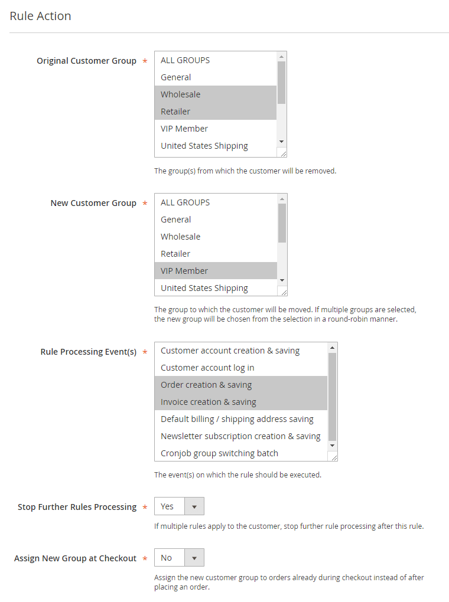

# Rule Action

In the Rule Action tab you can choose from and to which group(s) a customer should be moved and configure the rule processing options.

## Selecting Customer Groups

Select the group(s) from which the customer should be moved at 'Original Customer Group'.

Select the group where the customer should be moved to at 'New Customer Group'.

If multiple groups are selected, the new group will be automatically chosen from the selection in a round-robin manner, meaning that customers will be evenly distributed over the selected groups.

You can create and manage your customer groups by navigating to **Customers > General Settings > Customer Groups** in the left Admin Panel menu.

## Rule Processing Events

You can select the event(s) on which the rule should be executed at 'Rule Processing Event(s)'.

The rule processing events include actions related to customer accounts, orders and invoices, default shipping and billing address and newsletter subscriptions.

Besides that it's also possible to [process group switching rules on demand or periodically](./10-executing-customer-group-switching-rules.md).

## Stop Further Rules Processing

If you have created multiple group switching rules, it's possible that a customer can be classified into more than one customer group based on the configured conditions. The processing order of rules is defined by their priority, which can be set in the [Rule Information](./06-rule-information.md) tab. If you want to prevent customers from switching to another group after a certain rule, you can enable the 'Stop Further Rules Processing' option at the bottom of the Rule Actions tab.

## Assign New Group at Checkout

By enabling the 'Assign New Group at Checkout' option, the new customer group will be already assigned to new orders during checkout. By default the group switching rule is processed *after* placing an order, so the new customer group won't apply to the new order yet.

---

[Documentation index](./README.md) · [README](../README.md) · [Online version](https://plugin.company/knowledge-base/docs/magento-2-automatic-customer-group-switching/user-manual/rule-action/)
