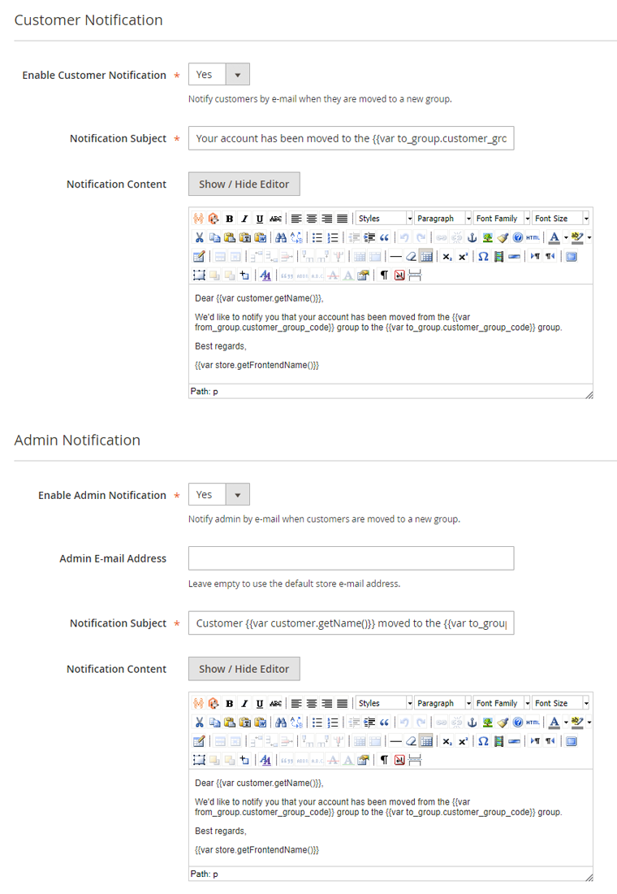

# Customer & Admin Notification

In the Customer and Admin Notification tabs you can optionally enable the e-mails that are sent to the customer and/or admin when customers are moved to a new group.

## Notification Variables

The e-mail subject and content of the customer and admin notifications support the use of the variables which are listed in the bottom section of the rule view, as well as custom variables and customer attributes.

| Variable | Description |
| --- | --- |
| `{{var customer.getName()}}` | Full customer name |
| `{{var customer.firstname}}` | Customer first name |
| `{{var customer.lastname}}` | Customer last name |
| `{{var customer.email}}` | Customer e-mail address |
| `{{var customer.getId()}}` | Customer ID |
| `{{var from_group.customer_group_code}}` | Group name from which the customer is moved |
| `{{var from_group.customer_group_id}}` | Group ID from which the customer is moved |
| `{{var to_group.customer_group_code}}` | Group name to which the customer is moved |
| `{{var to_group.customer_group_id}}` | Group ID to which the customer is moved |
| `{{var store.getFrontendName()}}` | Store name |
| `{{var store.getBaseUrl()}}` | Store URL |

---

[Documentation index](./README.md) · [README](../README.md) · [Online version](https://plugin.company/knowledge-base/docs/magento-2-automatic-customer-group-switching/user-manual/customer-admin-notification/)
