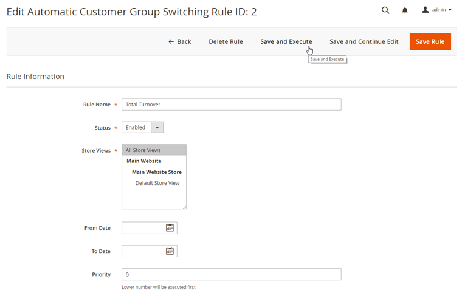
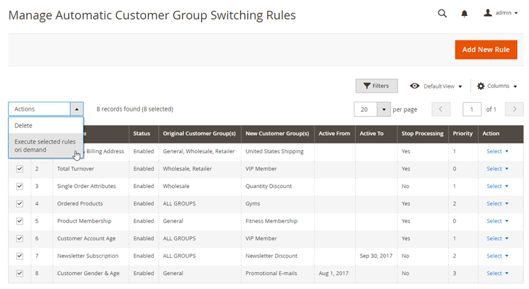
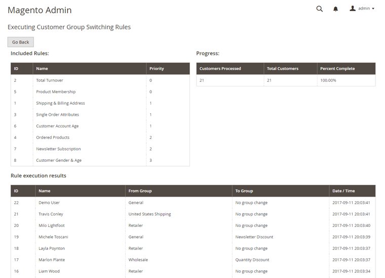
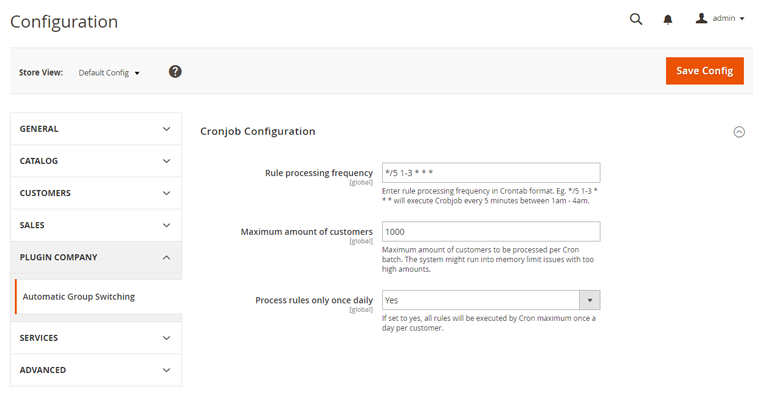

# Executing Customer Group Switching Rules

Automatic Customer Group Switching includes several options to execute rules: on specific [rule processing events](./08-rule-action.md#events), on demand (single rule or mass action) and periodically using Cron.

## Executing Rules On Demand

There are two options for executing group switching 'on demand'.

Individual rules can be processed by clicking the 'Save and Execute' button at the top of the rule view.

It's also possible to bulk process multiple rules at once by selecting them from the Automatic Customer Group Switching Rules grid. Choose the 'Execute selected rules on demand' option from the Actions dropdown menu in the top left corner of the page and click 'OK' to mass execute the selected rules.

A rule execution page will appear which shows which rule(s) and the amount of customers being processed, as well as an overview of the group switching activity per customer.

## Cronjob Configuration

The extension includes an integrated Cron functionality for periodical batch processing of customer group switching rules.

To process a rule using Cron, select 'Cronjob group switching batch' in the [Rule Processing Events](./08-rule-action.md#events) menu.

To configure the extension's Crobjob settings, navigate to **Customers > Automatic Customer Group Switching Rules > Configuration** in the left Admin Panel menu.

In the Cronjob Configuration you can define the rule processing frequency in Crontab format, set the maximum amount of customers to be processed per Cron batch and choose to execute the Cronjob only once daily.

Click the 'Save Config' button in the top right corner of the page to save any changes made to the Crobjob configuration.

---

[Documentation index](./README.md) · [README](../README.md) · [Online version](https://plugin.company/knowledge-base/docs/magento-2-automatic-customer-group-switching/user-manual/executing-customer-group-switching-rules/)
